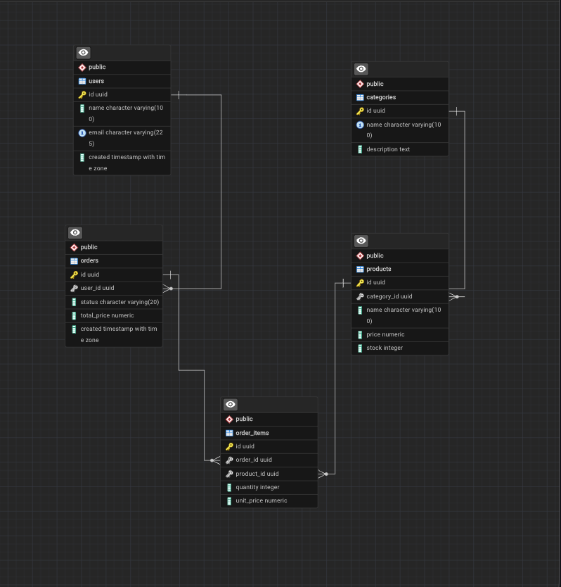

# RevoShop Database

PostgreSQL schema dan sample data untuk RevoShop — RevoU Backend Development Checkpoint 1.

## Struktur Tabel

| Tabel | Deskripsi |
|---|---|
| `users` | Data akun pengguna |
| `categories` | Kategori produk |
| `products` | Produk toko, terhubung ke kategori |
| `orders` | Order yang dibuat pengguna |
| `order_items` | Tabel penghubung orders dan products |

## Setup Lokal

### 1. Buat database di pgAdmin
- Buka pgAdmin → klik kanan Databases → Create → Database
- Nama database: `revoshop_db`

### 2. Jalankan schema
	psql -U postgres -d revoshop_db -f schema.sql

### 3. Masukkan sample data
	psql -U postgres -d revoshop_db -f seed.sql

### 4. Jalankan queries
	psql -U postgres -d revoshop_db -f queries.sql

## ERD

